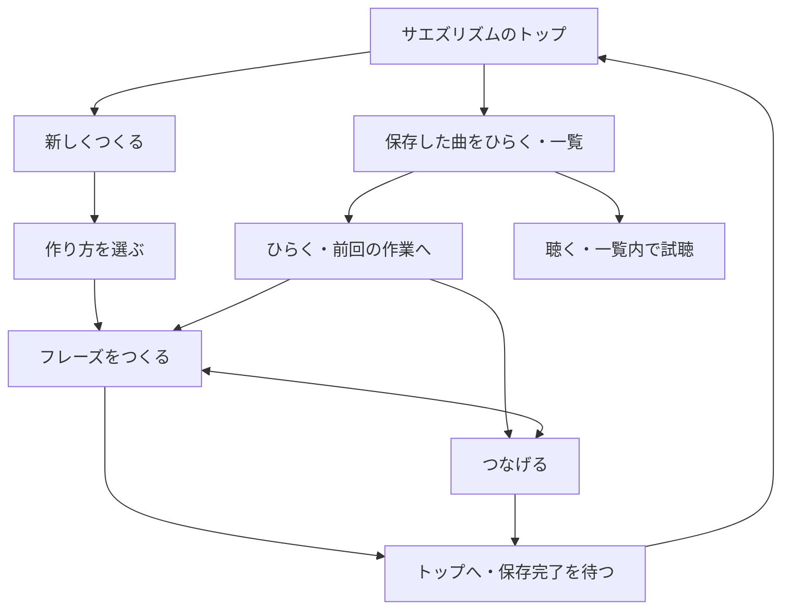

# 曲の選択・画面遷移の再整理 — 2026-10-31 合意

## 0. 扱い

正典は [要件定義書](../requirements-melody.md) と [実装ガイド](../implementation-guide.md)。A＝画面表現、B＝機能・ルールの変更と記録、C＝音声外部送信禁止・タッチ維持・2段階確定・別作品不変更の区分を継承する。画面案の確認と実装・公開の完了は区別する。2026-10-31の続きの対話で下記5点を承認し、その後に発案者から「デプロイまで進めて下さい」と指示された。追加公開の見合わせはこの指示で解除された。

## 1. 目的と保存単位

今どの曲を扱っているか、保存曲を開くことと一覧で試聴することが分かるようにする。曲は保存単位で、その中に複数の4／8小節のフレーズと配置順を持つ。曲ごとの保存と、別曲の材料を独立コピーする合意を維持する。全曲共通のフレーズ保管庫への変更ではない。

対象はML-007（登録・連結・配置修正）、ML-011（試聴）、ML-012（保存・一覧）、ML-016（曲の選択・遷移）。既存の音声方式・鍵盤・ハナウタ・録音の時計は変更しない。

## 2. 合意した入口と画面移動（ML-016）

1. サエズリズムのトップを「新しくつくる」「保存した曲をひらく」の2入口にする。
2. 新規は作り方を選んで制作へ進む。保存曲は一覧で曲を選んでから作業へ入る。曲未選択のまま空の連結画面へ進む入口をなくす。
3. 保存曲を開くと、前回の作業画面から再開する。今扱っている曲名を常に表示する。
4. 曲の中で「フレーズをつくる」と「つなげる」を直接切り替える。切替で曲・フレーズ・並びを失わず、トップや保存一覧へ戻る必要をなくす。
5. 「おてほん／使い方」はトップの大きな2ボタンの下に置く。
6. 前回画面が未記録の旧曲は、並びや登録フレーズがあれば「つなげる」、制作中フレーズだけなら「つくる」へ。以後は前回画面を記録して再開する。配置編集中の草稿は編集を再開できるよう保護する。
7. 作り方選択の「取消」は来た画面へ戻す。新規ならトップ、追加制作なら元の制作／連結画面。曲・フレーズ・並びを変更しない。

「前回の作業画面」は再開先を表し、図の「ひらく」から任意の方を毎回選び直す意味ではない。既存の音を置く／直す／伴奏も記録し、不明な値は既存方式に戻す。おてほん等の練習を保存曲の作業画面として記録しない。

## 3. 保存一覧と試聴（ML-011・012）

- 「ひらく」は選んだ曲の作業へ移動。「聴く」は一覧に留まって試聴する。両方を常設する。
- 名前変更・コピー・削除は「…」へまとめる。削除の対象確認と保存保護は維持する。
- 並べた順番があれば、曲全体をその順で聴く。まだ並べておらずフレーズが1つならそのフレーズを聴く。複数ある場合は、聴くフレーズを選んでから再生する。
- 未登録の制作中4／8小節も試聴対象に含める。どの曲・フレーズを聴いているか表示する。
- 複数フレーズの選択画面は一覧の上へ下から開く。曲名と登録済み／制作中／変更候補を表示。未確定の変更がある場合は「オッケー済みのところまで」と「仮の変更を含む・未確定」を分ける。選ぶと一覧内で試聴し、登録やオッケー確定はしない。
- 一覧での再生エラーと「その曲をひらく」は別の操作。再生に失敗しただけで開く操作を禁止しない。保存データを修復・削除したことにも扱わない。

## 4. 登録・追加制作・配置修正（ML-007）

- 作業は曲へ自動保存。「フレーズを登録」は保存の代わりではなく、今の4／8小節を連結用の材料に追加する操作。旧「フレーズにする」を改称する。
- 登録後に「つなげるへ」「もうひとつ つくる」を選べる。
- 「もうひとつ つくる」は、曲・登録済みフレーズ・並び・テンポを残して作り方選択へ進む。Aは鍵盤、Bはハナウタなど、別の作り方で同じ曲の材料を追加できる。
- 【保存保護の実装補足】制作中の内容が未登録なら、追加制作で上書きせず制作へ戻して登録を案内する。未確定なら先にオッケー／取消で整理する。自動登録・自動確定はしない。登録済みの材料は残したまま追加し、手入力・イメージ・作例のすべてで曲のテンポを保持する。
- A→B→Aの最後のAを修正する場合、元Aを残して修正版A2を作り、A→B→A2にする。先頭のAや他の配置を一括変更しない。既存の明示確定・取消・Undoを維持する。

## 5. 自動保存と終了（ML-012・016）

- 作業画面の「もどる」「やめる」を「トップへ」1つにまとめる。保存が成功してからトップへ戻る。
- フレーズと配置は保存曲に残り、次回「保存した曲をひらく」から再開する。保存したことを、未確定の音符や配置のオッケー確定に置き換えない。
- 保存失敗時はその画面に残し、再試行を案内。以前の保存内容とメモリ内の作業を保持し、未成功を「ほぞんしたよ」にしない。
- 保存失敗からの別操作として「未保存分を捨ててトップへ」を残す。対象曲と破棄範囲を別の確認画面で示し、そこで明示承認されるまで破棄しない。以前に保存成功した内容は変更・削除しない。保存成功したことのない新規曲はメモリ内作業だけを破棄する。
- 再試行の保存待ち中は閉じる・破棄・Escapeを止める。失敗した同じ内容を画面再描画だけで勝手に再送せず、「もういちど ほぞん」で再試行する。通常の編集による変更は引き続き自動保存する。古い終了処理が新しい作業へ作用しないよう操作の所有者を検査する。

## 6. 画面案で確認した点と実装で検証する点

| 項目 | 扱い・影響 |
|---|---|
| 再開先 | 【合意】前回画面を記録。旧曲は2節の内容別判定。任意フィールド追加で互換性を保ち、画面だけで空の保存曲を作らないことを検証 |
| 一覧の試聴選択 | 【画面案承認】下から開く選択画面と3状態の区別。確定版と変更候補の音が正しく分かれ、同名曲でも対象IDが一致することを検証 |
| トップへ／選択の取消 | 【合意】作業終了は保存してトップ、選択取消は来た画面。作業画面左上にトップへ、選択画面左上に取消を置く設計。保存中・失敗・ブラウザ戻るも保護する |
| 未保存分の破棄 | 【合意】別確認を経て残す。既存保存・進行中の保存キュー・競合した別タブの内容を変更しないことを検証 |
| おてほん・使い方 | 【画面案承認】トップの2入口の下。既存機能を維持 |

判断者は発案者。ここに記載した未決点は、合意済み内容を取り消す意味ではない。既存の見た目、スマホのスクロール抑制、44px操作・8px間隔、閉じる右上・停止中央、見える版とキャッシュ更新を維持する。新しいタイマー・音源・音声送信は追加しない。

## 7. 受入条件と実装状態

- 未選曲から保存曲を開き、前回画面・曲名・音符・伴奏・フレーズ・配置を復元できる。
- つくる／つなげるの往復、新フレーズ追加、一覧内試聴で選択曲がすり替わらない。同名の2曲でも識別して動く。
- 未配置1つ／複数、配置済み、制作中のみの試聴対象が合意の表と一致する。失敗しても同じ曲を開ける。
- 「トップへ」は保存完了前に遷移せず、失敗時も作業を保持する。
- 修正版の確定・取消・Undoで元フレーズと他の配置が保護される。
- 320／390px・横向き・文字拡大で曲名と操作が読み取れ、ボタンが重ならない。PCも維持する。

個別画面案と残る操作方針は承認済み。実装・公開は[実装計画と検証記録](workflow-implementation-20261031.md)で追跡する。既存の未公開4コード差分と新規エラー導線試験を保持して統合する。画面案の承認を実機の操作性や実声・音切れの検証完了と扱わない。

保存一覧での再生エラーは未解決。本人の記録は、エラー曲と編集で開いた曲のIDが異なり、本人も違う曲の可能性と導線の混乱を説明した。操作ミスとも保存消失とも断定せず、失敗した曲自体の保存内容を確認する課題として残す。

| 日付 | 内容 |
|---|---|
| 2026-10-31 | トップ・一覧・曲内切替・登録・追加制作・試聴対象・保存後のトップ遷移・配置だけの修正版を対話で合意し、一括記録。実装・公開とは区別 |
| 2026-10-31 続き | トップ補助入口、試聴選択と未確定表示、旧曲再開、選択取消、確認付き未保存分破棄を承認。デプロイまでの実行指示を受領 |
